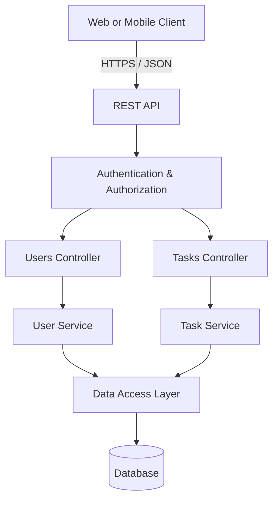
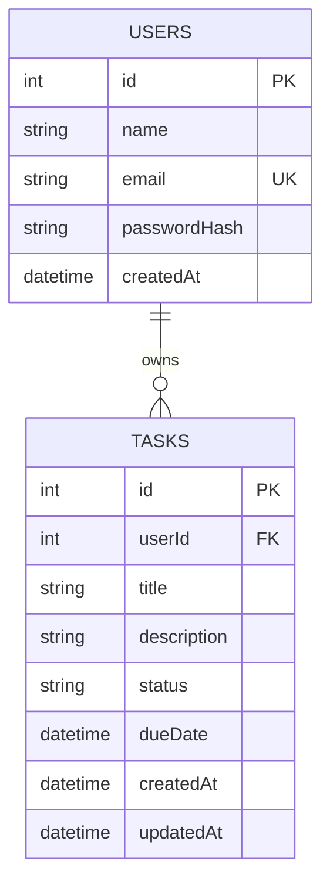

# System Architecture

## High-level architecture

The client communicates with the REST API over HTTPS. The API validates requests, applies authentication and authorization, runs business logic, and reads/writes data through the data-access layer.

## Resource relationship

## Component responsibilities

- **Client:** Sends HTTP requests and displays API responses.
- **REST API:** Exposes versioned endpoints under `/api/v1`.
- **Authentication & Authorization:** Validates bearer tokens and checks resource ownership/roles.
- **Users Controller / Service:** Handles user registration, profile retrieval, updates, and deletion.
- **Tasks Controller / Service:** Handles task creation, listing, retrieval, updates, and deletion.
- **Data Access Layer:** Encapsulates database queries.
- **Database:** Persists users and tasks; each task references its owner through `userId`.

## Design decisions

- REST-style resource URLs use plural nouns: `/users` and `/tasks`.
- API versioning is included in the URL: `/api/v1`.
- Tasks belong to one user through the `userId` foreign key.
- Authentication is required for private user and task operations.
